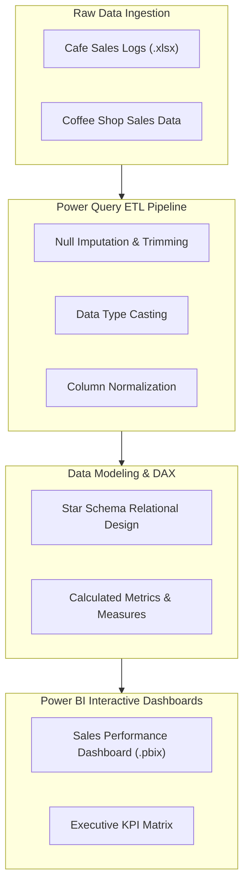

<p align="center">
  
</p>

<p align="center">
  
  
  
  
</p>

<a id="overview"></a>
## 📖 Executive Summary & Overview

The **Business Analytics Laboratory Suite** (`Business_Project_Analaysis-`) presents a multi-experiment portfolio demonstrating end-to-end business intelligence engineering. Real-world retail datasets frequently exhibit structural anomalies, including null tokens, unformatted timestamps, mismatched currencies, and inconsistent product taxonomies.

This project synthesizes **Experiment 2**, **Experiment 3**, **Experiment 4**, and **Assignment 6**, establishing systematic data cleaning protocols using **Power Query M**, financial metric calculations via **DAX**, and multi-page dashboard visualizations in **Power BI Desktop**.

<a id="toc"></a>
## 📑 Table of Contents

- [📖 Executive Summary & Overview](#overview)
- [🎯 Key Features & Capabilities](#features)
- [🏗️ System Architecture & Pipeline](#architecture)
- [🛠️ Tech Stack Breakdown](#tech-stack)
- [⚙️ Reproducible Quickstart & Setup](#setup)
- [📁 Project Directory Layout](#project-layout)
- [👨‍💻 Author & Contributions](#author)

<a id="features"></a>
## 🎯 Key Features & Capabilities

- **Power Query Data Cleansing (Exp 4):** Automated cleaning pipelines for cafe sales datasets: trimming whitespace, imputing missing values, and type casting.
- **Multi-Location Coffee Shop Analytics (Exp 3):** Full dashboard deployment analyzing unit economics, customer order volume, and geographic store performance.
- **Advanced DAX KPI Engineering:** Custom DAX measures for Year-to-Date (YTD) revenue, moving averages, and transaction frequency.
- **Formal Academic Documentation:** Detailed experimental reports (`.pdf`) validating methodology, hypothesis formulation, and analytical conclusions.

<a id="architecture"></a>
## 🏗️ System Architecture & Pipeline



<a id="tech-stack"></a>
## 🛠️ Tech Stack Breakdown

| Component | Tool / Language | Functional Role |
| :--- | :--- | :--- |
| **ETL & Data Munging** | Power Query M | Cleaning and shaping raw commercial datasets |
| **Data Modeling** | Power BI DAX | Calculating dynamic time-series and aggregate KPIs |
| **Reporting Engine** | Microsoft Power BI Desktop | Interactive visual reports (`.pbix`) |
| **Data Formats** | Excel (`.xlsx`), CSV | Structured source transactional files |
| **Documentation** | LaTeX / Word / PDF | Formal academic lab reports and methodology logs |

<a id="setup"></a>
## ⚙️ Reproducible Quickstart & Setup

### Prerequisites
- Microsoft Power BI Desktop (May 2024 or newer recommended)
- Microsoft Office or LibreOffice Calc

```bash
# 1. Clone repository
git clone https://github.com/Amaraiah11/Business_Project_Analaysis-.git
cd Business_Project_Analaysis-

# 2. Open any experimental Power BI report
# Example: Experiment 4 Cafe Sales
start "Experiment 4/Experiment 4 (1).pbix"

# Example: Experiment 3 Coffee Shop Dashboard
start "Experiment 3/Coffee shop dashboard project (1).pbix"
```

<a id="project-layout"></a>
## 📁 Project Directory Layout

```text
Business_Project_Analaysis-/
├── BA assignment 6.pdf                               # Formal assignment report
├── README.md                                         # Main project documentation
├── Experiment 2/
│   ├── EXP-2 (Report).pdf                           # Experiment 2 methodology report
│   └── Experiment 2.pbix                            # Power BI visual analytics file
├── Experiment 3/
│   ├── Coffee shop dashboard project (1).pbix       # Coffee shop dashboard
│   ├── Coffee Shop Sales.xlsx                       # Source dataset
│   └── Exp_3 Report.pdf                             # Lab report
└── Experiment 4/
    ├── Cafe_Sales_Data_Cleaning_Report_Analaysis.pdf # Power Query data cleaning report
    └── Experiment 4 (1).pbix                        # Cleaned data model & visual report
```

<a id="author"></a>
## 👨‍💻 Author & Contributions

This project is developed and maintained with high technical rigour by **Amaraiah C**, Software Engineer and Data Analytics Practitioner studying Bachelor of Computer Applications (BCA) at Alliance University.

- 🌐 **GitHub:** [@Amaraiah11](https://github.com/Amaraiah11)
- 💼 **LinkedIn:** [Connect on LinkedIn](https://www.linkedin.com/in/amaraiah-c/)
- 📧 **Institutional Contact:** `camaraiahBCA24@ced.alliance.edu.in`

### 🤝 Contribution Guidelines
Contributions, bug reports, and architectural discussions are welcome!
1. **Fork** the repository: `https://github.com/Amaraiah11/Business_Project_Analaysis-`
2. **Branch**: `git checkout -b feature/your-feature-name`
3. **Commit**: `git commit -m "feat: enhance feature logic"`
4. **Push**: `git push origin feature/your-feature-name`
5. **Open Pull Request** against the `Amaraiah-C` branch.

---

<p align="center">
  <b>⭐ If this codebase or documentation assisted your engineering workflows, please star the repository! ⭐</b>
</p>

<p align="center">
  
</p>
