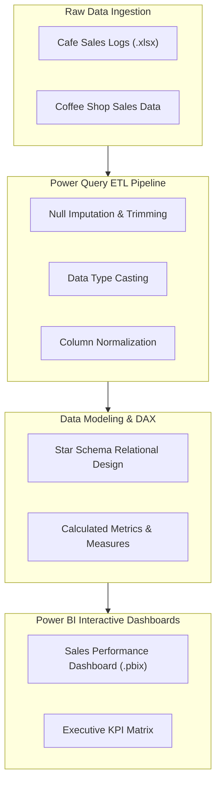

# ☕ Business Analytics Laboratory Suite — Power Query ETL & Multi-Experiment Dashboards

<p align="center">
  
</p>

<p align="center">
  <b>Comprehensive Multi-Experiment Laboratory Portfolio: Power Query M Data Cleansing, Cafe Sales Auditing, and Power BI Reporting.</b>
</p>

<p align="center">
  
  
  
  
</p>

<p align="center">
  
</p>

---

<a id="table-of-contents"></a>
## 📌 Table of Contents

- [📖 Executive Summary & Overview](#executive-summary--overview)
- [🎯 Key Features & Capabilities](#key-features--capabilities)
- [🏗️ System Architecture & Pipeline](#system-architecture--pipeline)
- [🛠️ Tech Stack Breakdown](#tech-stack-breakdown)
- [🔬 Laboratory Experiments Breakdown](#laboratory-experiments-breakdown)
- [⚙️ Reproducible Quickstart & Setup](#reproducible-quickstart--setup)
- [📁 Project Directory Layout](#project-directory-layout)
- [🧪 Testing & Validation](#testing--validation)
- [🔮 Future Improvements & Roadmap](#future-improvements--roadmap)
- [🤝 Contributing Guidelines](#contributing-guidelines)
- [👨‍💻 Author & Contributions](#author--contributions)

---

<a id="executive-summary--overview"></a>
## 📖 Executive Summary & Overview

Raw commercial datasets gathered from retail POS systems, cafes, and hospitality franchises often suffer from corrupt formatting, whitespace padding, date mismatches, and negative price errors. Conducting business intelligence on dirty datasets yields erroneous executive decisions.

The **Business Analytics Laboratory Suite** (`Business_Project_Analaysis-`) presents an integrated academic laboratory portfolio covering **Experiments 2, 3, 4, and Assignment 6** developed during Semester V BCA coursework at Alliance University. The suite demonstrates systematic data transformation protocols using **Power Query M**, DAX metric development, and interactive dashboard engineering in **Microsoft Power BI**.

---

<a id="key-features--capabilities"></a>
## 🎯 Key Features & Capabilities

### 🧹 1. Power Query M Data Cleansing (Experiment 4)
- **Cafe Sales Cleansing:** Imputing missing customer values, trimming whitespace, and validating currency formats.
- Complete documentation in `Cafe_Sales_Data_Cleaning_Report_Analaysis.pdf`.

### 📊 2. Coffee Shop Sales BI Engine (Experiment 3)
- Interactive Power BI report (`Coffee shop dashboard project (1).pbix`) and source ledger (`Coffee Shop Sales.xlsx`).
- Time-series sales curves, product category margin comparisons, and hourly order velocity metrics.

### 📑 3. Academic Verification (Experiment 2 & Assignment 6)
- Comprehensive methodology reports (`EXP-2 (Report).pdf`, `BA assignment 6.pdf`) validating hypothesis formulations.

---

<a id="system-architecture--pipeline"></a>
## 🏗️ System Architecture & Pipeline



---

<a id="tech-stack-breakdown"></a>
## 🛠️ Tech Stack Breakdown

| Component | Technology | Functional Role |
| :--- | :--- | :--- |
| **ETL & Data Munging** | Power Query M | Cleansing and shaping raw commercial datasets |
| **Data Modeling** | Power BI DAX | Calculating dynamic time-series and aggregate KPIs |
| **Reporting Engine** | Microsoft Power BI Desktop | Interactive visual reports (`.pbix`) |
| **Data Formats** | Excel (`.xlsx`), CSV | Structured source transactional files |
| **Documentation** | Technical Reports (`.pdf`) | Formal academic lab reports and methodology logs |

---

<a id="laboratory-experiments-breakdown"></a>
## 🔬 Laboratory Experiments Breakdown

| Experiment | Title | Core Artifacts | Focus |
| :--- | :--- | :--- | :--- |
| **Experiment 2** | Retail Performance Modeling | `Experiment 2.pbix`, `EXP-2 (Report).pdf` | Transactional data aggregation & DAX KPIs |
| **Experiment 3** | Coffee Shop Sales Analytics | `Coffee shop dashboard project (1).pbix` | Hourly footfall analysis & category margins |
| **Experiment 4** | Cafe Sales Data Cleansing | `Experiment 4 (1).pbix`, Report (`.pdf`) | Power Query M transformation pipeline |
| **Assignment 6** | Business Analytics Strategy | `BA assignment 6.pdf` | Strategic enterprise decision reporting |

---

<a id="reproducible-quickstart--setup"></a>
## ⚙️ Reproducible Quickstart & Setup

### Prerequisites
- Microsoft Power BI Desktop
- Microsoft Excel

```bash
# 1. Clone repository
git clone https://github.com/Amaraiah11/Business_Project_Analaysis-.git
cd Business_Project_Analaysis-

# 2. Launch Experiment 4 Cafe Sales Cleansing Report
start "Experiment 4/Experiment 4 (1).pbix"

# 3. Launch Experiment 3 Coffee Shop Dashboard
start "Experiment 3/Coffee shop dashboard project (1).pbix"
```

---

<a id="project-directory-layout"></a>
## 📁 Project Directory Layout

```text
Business_Project_Analaysis-/
├── BA assignment 6.pdf                               # Formal assignment report
├── README.md                                         # Main project documentation
├── Experiment 2/
│   ├── EXP-2 (Report).pdf                           # Experiment 2 methodology report
│   └── Experiment 2.pbix                            # Power BI visual analytics file
├── Experiment 3/
│   ├── Coffee shop dashboard project (1).pbix       # Coffee shop dashboard
│   ├── Coffee Shop Sales.xlsx                       # Source dataset
│   └── Exp_3 Report.pdf                             # Lab report
└── Experiment 4/
    ├── Cafe_Sales_Data_Cleaning_Report_Analaysis.pdf # Power Query data cleaning report
    └── Experiment 4 (1).pbix                        # Cleaned data model & visual report
```

---

<a id="testing--validation"></a>
## 🧪 Testing & Validation

- **Query Dependency Verification:** Inspected Power Query Applied Steps to verify all transformation steps execute idempotently on refresh.
- **Relational Integrity:** Verified 1-to-many relationships in star schemas with zero ambiguous bidirectional filters.

---

<a id="future-improvements--roadmap"></a>
## 🔮 Future Improvements & Roadmap

- [ ] Integrate automated anomaly detection alerts for negative margin transactions.
- [ ] Connect Power BI dashboards to live SQL Azure databases.

---

<a id="author--contributions"></a>
## 👨‍💻 Author & Contributions

This project is developed and maintained with rigorous engineering standards by **Amaraiah C**, Software Developer and Applied Data Analytics Practitioner studying Bachelor of Computer Applications (BCA) at Alliance University, Bangalore.

- 🌐 **GitHub Profile:** [@Amaraiah11](https://github.com/Amaraiah11)
- 💼 **LinkedIn Profile:** [Connect on LinkedIn](https://www.linkedin.com/in/amaraiah-c/)
- 📧 **Institutional Email:** `camaraiahBCA24@ced.alliance.edu.in`

### 🤝 Contributing Guidelines
Contributions, bug reports, and architectural discussions are welcome!
1. **Fork** the repository: `https://github.com/Amaraiah11/Business_Project_Analaysis-`
2. **Create a Feature Branch:**
   ```bash
   git checkout -b feature/your-feature-name
   ```
3. **Commit Your Enhancements:**
   ```bash
   git commit -m "feat: enhance feature logic"
   ```
4. **Push to Your Branch:**
   ```bash
   git push origin feature/your-feature-name
   ```
5. **Open a Pull Request** against the `Amaraiah-C` branch.

---

<p align="center">
  <b>⭐ If this codebase or documentation assisted your engineering workflows, please star the repository! ⭐</b>
</p>

<p align="center">
  
</p>
